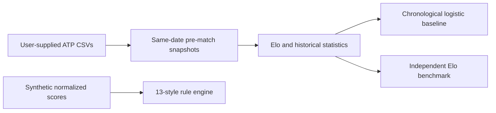

# Tennis Match Prediction: portfolio edition

A compact, reproducible excerpt of a larger tennis analytics research project.
It demonstrates chronological ATP features, an Elo baseline, temporal model
evaluation, and an interpretable 13-archetype style rule engine. This public
edition contains **no tennis match data, trained model, database, odds, or
betting logic**. The original local research project and its runtime R2 model
are separate; numbers from that runtime must not be attributed to this code.

## What is here

| Path | Purpose |
| --- | --- |
| `tennis_portfolio/features.py` | Main-draw CSV loading, same-date batch snapshots, Elo, form, surface and service/return history. |
| `tennis_portfolio/train.py` | Logistic baseline, chronological train/validation/test splits and Elo comparison. |
| `tennis_portfolio/style_rule_engine.py` | Selected 13-archetype candidate rules from the larger research project. |
| `tennis_portfolio/style_taxonomy.py` | Style names and human-readable descriptions. |
| `tennis_portfolio/demo.py` | Synthetic demonstration with no external data. |
| `tests/` | Temporal leakage, pair orientation, surface isolation and style checks. |

The style rules are **hand-designed analytical archetypes**, not unsupervised
clusters. They are not input to the model in this edition. Rules expect
normalized player scores (0-100) calculated by the larger research project;
the synthetic demonstration illustrates their API rather than estimating
real players' styles.



## Quick start

```bash
python -m venv .venv
# Activate the environment using your platform's command.
python -m pip install -r requirements.txt
python -m pytest -q
python -m tennis_portfolio.demo
```

To train the **portfolio baseline**, provide your own directory containing
`atp_matches_2000.csv` through `atp_matches_2025.csv` where available:

```bash
python -m tennis_portfolio.train --data-dir /path/to/atp-csv-directory
```

The protocol trains on matches through 2019, checks 2020-2022 and evaluates
2023-2025. This script prints metrics; it does not save a fitted model.

One local reference run on the available ATP CSV snapshot produced the
following results. These values describe this **portfolio baseline only**;
they are not R2 runtime or betting metrics.

| Split | Matches | Model log loss | Elo log loss | Model Brier | Elo Brier |
| --- | ---: | ---: | ---: | ---: | ---: |
| Validation 2020-2022 | 7,112 | 0.6105 | 0.6251 | 0.2120 | 0.2180 |
| Test 2023-2025 | 8,953 | 0.6241 | 0.6351 | 0.2175 | 0.2220 |

## Anti-leakage and limitations

- Players are ordered by ID, independent of who won. `target=1` means the
  lower-ID player won.
- Features for all matches with the same `tourney_date` are snapshotted
  before any of their results are applied. Jeff Sackmann's `tourney_date` is
  a tournament date, not necessarily the precise day of each match.
- Match-level service statistics update future history only after snapshots.
- Missing historical service/ranking values remain missing until model
  preprocessing; the first match has no historical win-rate estimate.
- This small baseline does not reproduce the research project's calibrated
  R2 runtime model, MCP validation suite, tactical UI or market analyses.
- No result in this repository establishes betting profitability.

## Data attribution and publication scope

This repository does not mirror or redistribute data. It documents the source
formats of Jeff Sackmann's tennis datasets and the Tennis Abstract Match
Charting Project. The latter is licensed CC BY-NC-SA 4.0: attribution is
required, use is non-commercial, and adapted data has share-alike terms.
Review the current terms of each source before obtaining or publishing data
or derived datasets. Source: [Match Charting Project](https://github.com/JeffSackmann/tennis_MatchChartingProject).

## Relationship to the full project

The full local project also contains SQLite, R2 prediction, XGBoost research,
MCP/PBP parsing, tactical profiles, Style v2, model governance and extensive
QA. This repository deliberately keeps a small executable path for code
review. Its metrics should be generated afresh from data supplied by the user.
